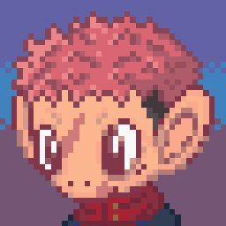
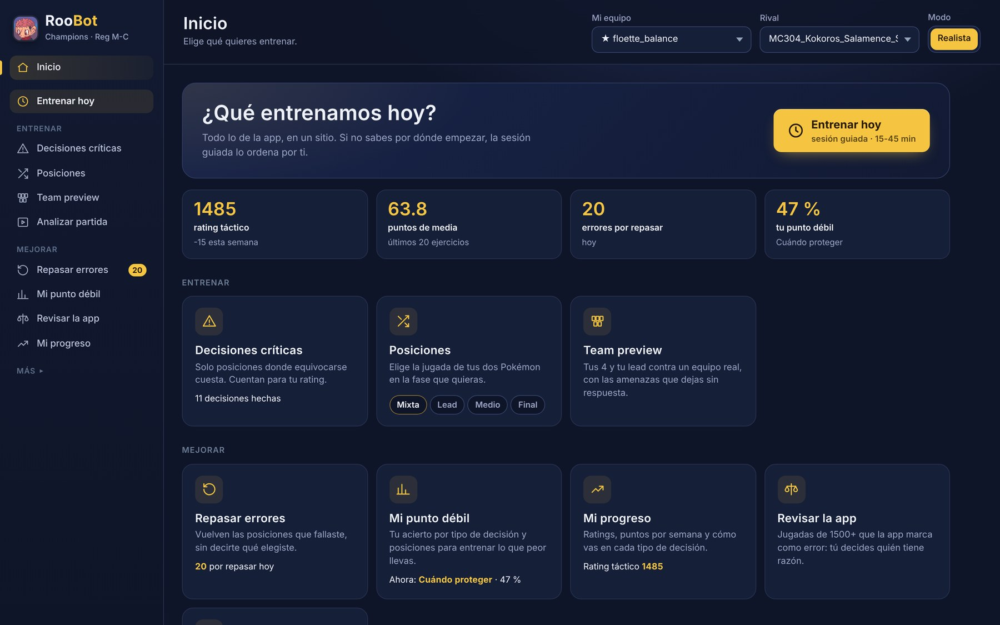
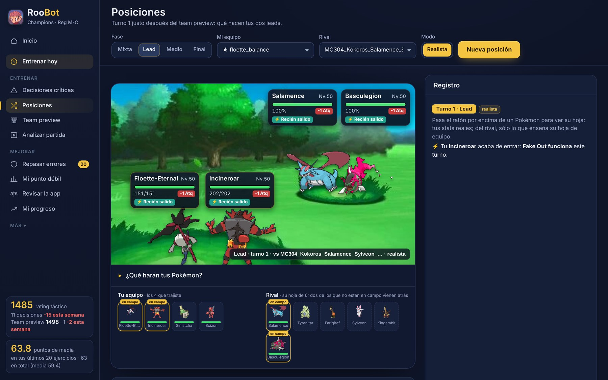
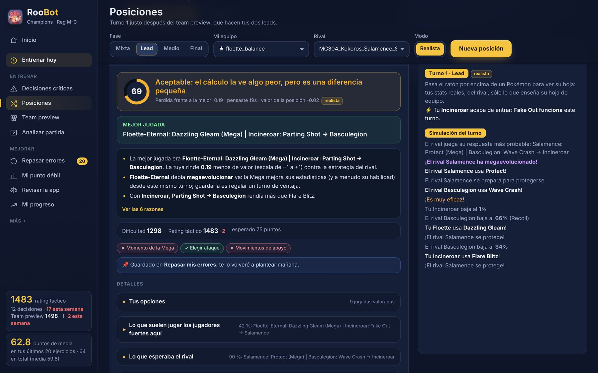
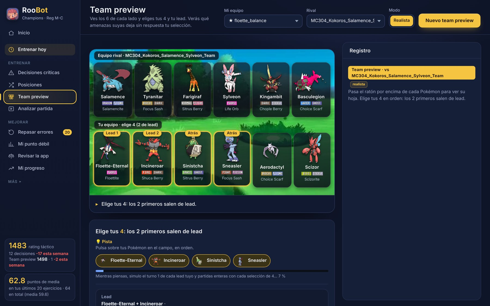
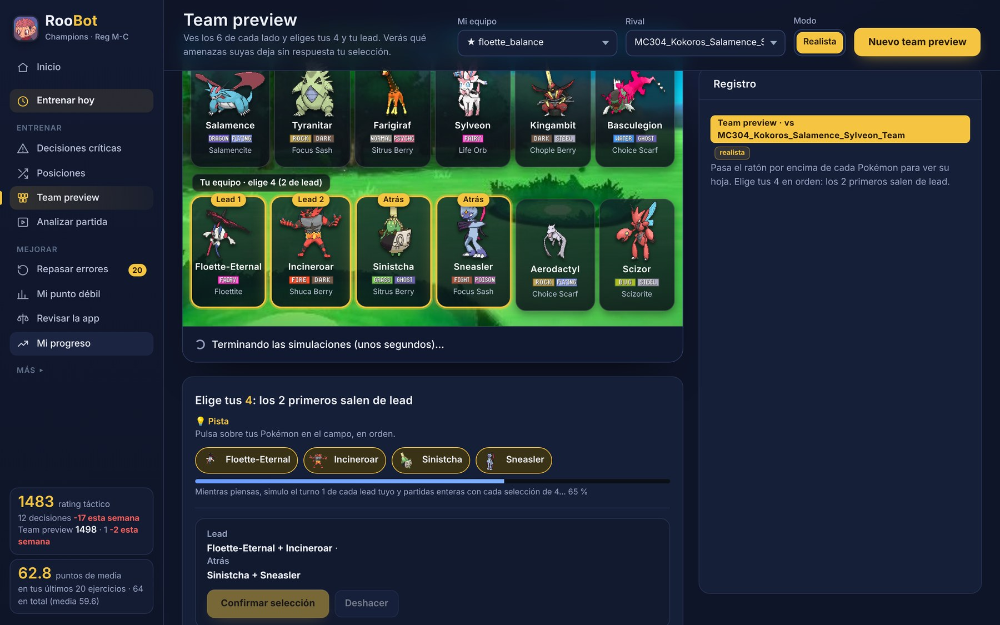
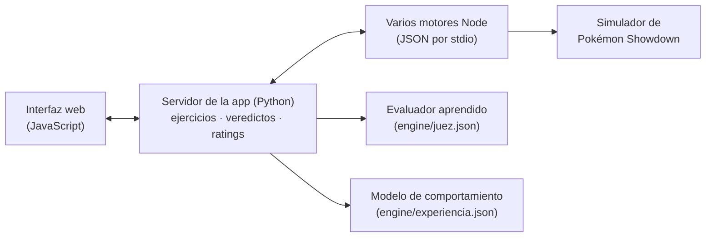

<p align="center">
  
</p>

<h1 align="center">RooBot</h1>

<p align="center">
  <b>Entrenador táctico para el Pokémon competitivo de dobles (VGC · Pokémon Champions, Reg M-C).</b><br>
  Convierte posiciones reales de combate en ejercicios, resuelve cada una como un juego de movimientos simultáneos
  sobre el simulador real y te explica cuál era la mejor jugada y por qué.
</p>

<p align="center">
  
</p>

> Manual completo: [docs/MANUAL_ES.md](docs/MANUAL_ES.md) · English version: [docs/README_EN.md](docs/README_EN.md).
> RooBot es una **herramienta de entrenamiento**: funciona solo en tu ordenador y nunca juega en el ladder ni en torneos.

---

## Qué hace

| | |
|---|---|
| **Posiciones y decisiones críticas** | Posiciones reales (lead, medio juego y final) que salen de partidas internas con tu equipo. Eliges movimiento y objetivo para tus dos Pokémon y recibes un veredicto, la mejor jugada y sus razones. «Decisiones críticas» se queda solo con las posiciones en las que la jugada que más tienta pierde mucho. |
| **Lecturas (50/50)** | Posiciones sin una jugada dominante. Ves la matriz de pagos (tus jugadas × las respuestas probables del rival) y con qué frecuencia juega cada opción la estrategia mixta óptima. |
| **Team preview** | Eliges tus 4 y tu lead contra un equipo real de torneo. Se simula cada selección (turno 1 y partidas enteras), con la matriz «quién gana a quién» y las amenazas que tu selección deja sin respuesta. |
| **Analizar partida** | Pegas una repetición de Showdown y se reconstruye y evalúa cada turno (✓ / ?! / ✗), usando solo lo que podías ver en esa partida (hoja abierta, sin stats ocultos). |
| **Partidas contra el bot** | Bo1 o Bo3 contra un bot basado en búsqueda, con informe turno a turno al terminar. |
| **Ciclo de aprendizaje** | Repaso espaciado de tus errores, rating táctico tipo Elo, acierto por tipo de decisión (proteger, Fake Out, objetivo, Mega, cambios…) y una sesión guiada diaria. |

<p align="center">
  
  
</p>
<p align="center">
  
  
</p>

## Cómo funciona



- **Búsqueda de movimientos simultáneos.** Cada turno es un juego matricial. Un filtro rápido (daño esperado, amenazas de KO, control de velocidad) se queda con las mejores jugadas conjuntas de cada bando. Cada pareja se simula con el motor real de Showdown en varios **mundos posibles** (sets desconocidos, Pokémon aún sin revelar) y con varias semillas de azar. La matriz se resuelve con **regret matching+**. El resultado es una estrategia mixta, el valor de cada opción y lo que se espera que juegue el rival. Cuando quedan 2 Pokémon o menos por bando, un **resolutor de finales** juega la partida hasta el final.
- **Información oculta como en un torneo.** Lo que no se ve del rival (stat points, habilidad, objeto, movimientos) se completa con el **set real más parecido** entre más de 390 equipos de torneo importados, nunca con el set verdadero.
- **Evaluador de posiciones aprendido.** Es un modelo logístico **por fase de la partida** sobre el evaluador escrito a mano, con 28 rasgos (vida, control de velocidad, amenazas, estados, pantallas, Mega por usar, presión desde el banquillo…). Se entrenó con **30.768 posiciones de 2.209 partidas con rating**, con restricciones de signo, regularización hacia el evaluador original elegida por validación cruzada (4 particiones) y más peso a las partidas de mayor rating. Solo se activa si predice el ganador mejor que el original en partidas que no vio (66,6 % frente a 64,1 %).
- **Modelo de «experiencia».** Es un logit condicional que aprende lo que eligen los jugadores fuertes (49 rasgos por opción), entrenado con **46.468 decisiones** de jugadores de 1300+. Acierta la jugada exacta el 34 % de las veces, frente al 31 % del filtro heurístico y el 14 % del azar. En cada análisis aparece como «lo que suelen jugar los fuertes aquí».

## Medirlo con honestidad

Lo más interesante del proyecto no fue la búsqueda, sino **comprobar si los consejos son correctos**:

1. **Bancos de prueba fijos.** Son repeticiones de rating alto que nunca se usan para aprender: uno con hojas abiertas, uno de ladder y uno de evaluación con 100 partidas. Las semillas son fijas, así que dos versiones se comparan decisión a decisión. Frente a jugadores de 1500+, RooBot coincide en **~64 %** de las decisiones del banco con hojas abiertas.
2. **Revisión humana.** El acuerdo no dice quién se equivocó, si la app o el jugador. Por eso revisé a mano **55 decisiones** de jugadores de 1500+ que la app marcaba como error. La app solo tenía razón en el **5 %**; en el 53 % la tenía el jugador y en el 42 % valían las dos.
3. **Diagnóstico y arreglo.** Los errores falsos se concentraban cuando el jugador hacía una jugada *de plan* (proteger, cambiar, estados, control de velocidad) y la app prefería atacar: acertó 1 de 28. Es el punto débil típico de mirar un solo turno. Ahora esos casos se marcan como **«discutible»** en vez de «error», y los errores falsos de la revisión bajaron a la mitad sin perder los aciertos de la app.
4. **Barreras de seguridad.** Esa revisión es ahora una prueba de regresión. Los experimentos automáticos que ajustan el evaluador tienen que mejorar el acuerdo en dos bancos independientes **y** no añadir errores falsos en la revisión.

Probé y descarté, porque los bancos dijeron que no: mirar dos turnos, un rival «robusto», un objetivo tipo TD y evaluadores con gradient boosting o redes neuronales (MLP).

## Cómo empezar (Windows)

Necesitas **Python 3.10+**, **Node.js 20+** y **Git**.

```bat
instalar.bat          :: descarga y compila la versión probada de Pokémon Showdown e instala numpy y pyyaml
app.bat               :: abre la app en http://127.0.0.1:8765 (solo en tu PC)
mantenimiento.bat     :: menú: importar equipos, sprites, actualizar y medir el evaluador, experimentos
```

Pruebas automáticas (no necesitan el simulador): `pip install pytest` y `python -m pytest tests`.

Los sprites no van en el repositorio. Ejecuta una vez `mantenimiento.bat` → opción 2 con internet para descargarlos, o deja que la app los baje cuando los necesite.

## Estructura

```
engine/     Node: Showdown, cálculo de daño, búsqueda, team preview, lector de repeticiones, modelo de comportamiento
vgclab/     Python: servidor de la app, calibración y aprendizaje, experimentos, importador, calculadora de supervivencia
web/        Interfaz (index.html) y logo
teams/      Equipos de ejemplo y equipos de torneo de Reg M-C importados (teams/mc)
docs/       Manual completo, versión en inglés y capturas
```

Unas 13.000 líneas de código (Python ≈ 5.800, motor JavaScript ≈ 4.100, interfaz ≈ 3.000).

## Uso responsable

RooBot es para practicar y analizar. Todo funciona en tu ordenador (el servidor web solo escucha en 127.0.0.1). Solo descarga repeticiones públicas, equipos y sprites, y nunca inicia sesión en Showdown ni juega por ti en el ladder ni en torneos.

## Aviso legal y licencia

El código está bajo [licencia MIT](LICENSE). Pokémon y todos los nombres relacionados son marcas de Nintendo, Game Freak y The Pokémon Company. Este es un proyecto de fans no oficial, sin relación con ellos ni con Smogon / Pokémon Showdown. Las capturas muestran sprites de Pokémon Showdown.
