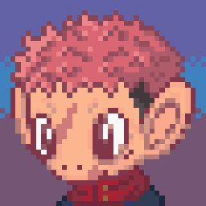
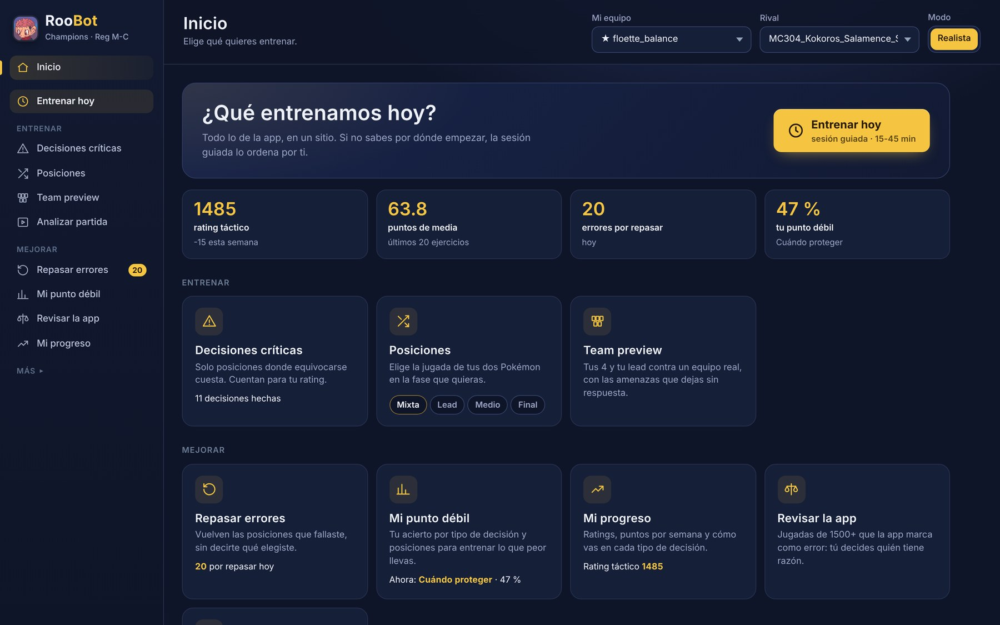
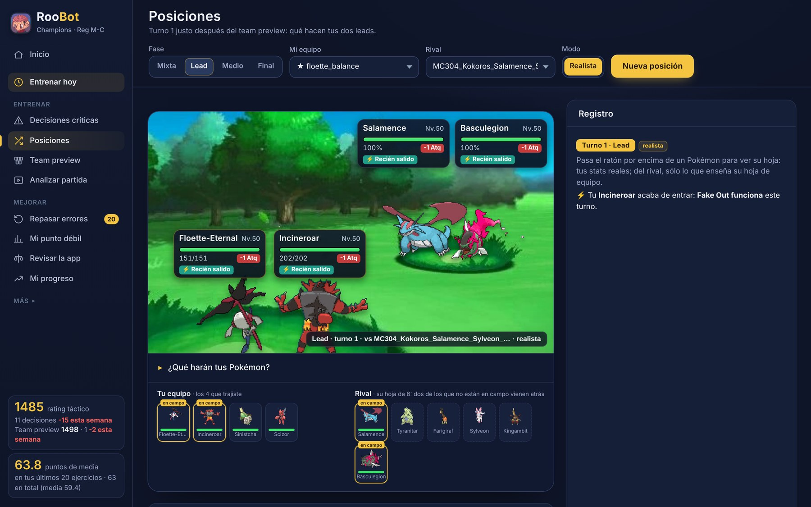
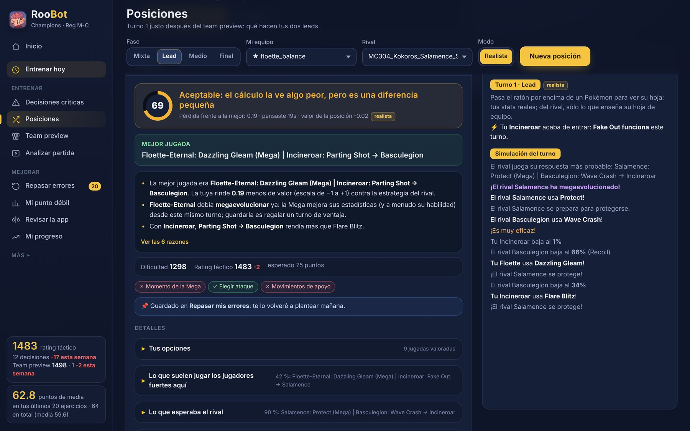
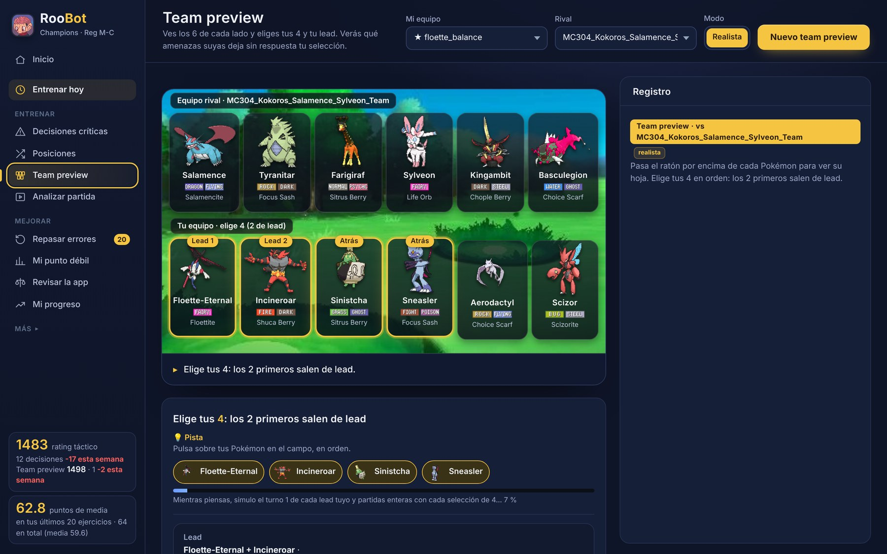
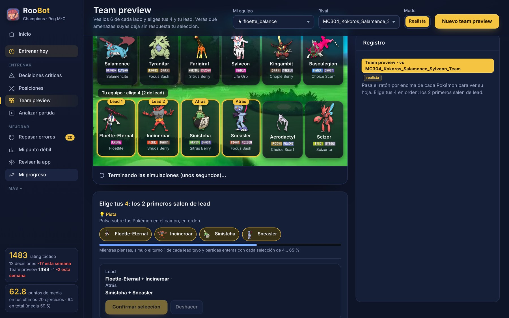
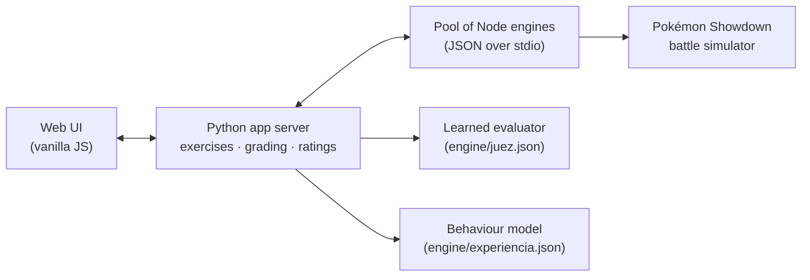

<p align="center">
  
</p>

<h1 align="center">RooBot</h1>

<p align="center">
  <b>A tactical trainer for competitive Pokémon doubles (VGC · Pokémon Champions, Reg M-C).</b><br>
  It turns real battle positions into exercises, solves each one as a simultaneous-move game on the real battle simulator,
  and explains which play was best and why.
</p>

<p align="center">
  
</p>

> Versión en español: [README](../README.md). The interface and the full manual are in Spanish → [MANUAL_ES.md](MANUAL_ES.md).
> RooBot is a **training tool**: it runs only on your own computer and never plays on the ladder or in tournaments.

---

## What it does

| | |
|---|---|
| **Positions & critical decisions** | Real positions (lead, mid-game, endgame) generated by playing internal games with your team. Pick a move and a target for both Pokémon, then get a verdict, the best play and the reasons behind it. "Critical decisions" keeps only positions where the tempting play loses a lot. |
| **50/50 reads** | Positions with no dominant play: you see the payoff matrix (your plays × the opponent's likely replies) and how often the optimal mixed strategy plays each option. |
| **Team preview** | Choose your 4 and your leads against a real tournament team. Every selection is simulated (turn 1 plus whole games), with a who-beats-whom matrix and the threats your selection leaves unanswered. |
| **Replay analyzer** | Paste a Showdown replay: every turn is rebuilt and graded (✓ / ?! / ✗), using only what you could see in that game (open team sheet, no hidden stats). |
| **Games vs the bot** | Bo1 / Bo3 against a search-based bot, with a turn-by-turn report at the end. |
| **Learning loop** | Spaced-repetition review of your mistakes, Elo-style tactical rating, accuracy by decision type (protect, Fake Out, targeting, Mega timing, switching…) and a guided daily session. |

<p align="center">
  
  
</p>
<p align="center">
  
  
</p>

## How it works



- **Simultaneous-move search.** Each turn is a matrix game. A cheap prior (expected damage, KO threats, speed control) keeps the best joint actions for each side. Every pair is then simulated with the real Showdown engine across several *possible worlds* (unknown sets, unrevealed Pokémon) and RNG seeds. The payoff matrix is solved with **regret matching+**, which gives a mixed strategy, the value of every option and what the opponent is expected to play. When two or fewer Pokémon remain per side, an **endgame solver** plays the game out to the end.
- **Hidden information like in a real tournament.** The opponent's unseen details (stat points, ability, item, moves) are completed from the **closest real set** among 390+ imported tournament teams, never from the true set.
- **Learned position evaluator.** A logistic model **per game phase** sits on top of a hand-tuned evaluator. It has 28 features (HP, speed control, threats, status, screens, Mega availability, bench pressure…). It was trained on **30,768 positions from 2,209 rated games**, with sign constraints, regularisation towards the hand-tuned prior chosen by 4-fold cross-validation, and rating-weighted samples. It is only activated if it predicts the winner better than the baseline on held-out games (66.6 % vs 64.1 %).
- **"Experience" model.** A conditional-logit model of what strong players choose (49 features per option), trained on **46,468 decisions** from 1300+ players. Top-1 accuracy is 34 %, against 31 % for the heuristic prior and 14 % for chance. It is shown as "what strong players usually do here".

## Measuring it honestly

The most interesting part of the project was not the search but **measuring whether the advice is right**:

1. **Fixed benchmarks.** These are banks of high-rated replays that are never used for training: open team sheets, ladder, and a 100-game evaluation bank. World seeds are fixed, so two versions can be compared decision by decision. Against 1500+ players, RooBot agrees with **~64 %** of decisions on the open-team-sheet bank.
2. **Human review.** Agreement alone can't tell whether the app or the player was wrong, so I reviewed by hand **55 decisions** that the app flagged as errors made by 1500+ players. The app was right in only **5 %** of them; in 53 % the player was right and in 42 % both plays were fine.
3. **Diagnosis and fix.** The false errors clustered where the player made a *plan* move (protect, switch, status, speed control) and the app preferred to attack: 1 correct call out of 28. This is the classic weakness of a one-turn horizon. Those cases are now graded **"debatable"** instead of "error", which halved the false errors on the review set while keeping the app's correct calls.
4. **Guard-rails.** That review set is now a regression test. Automatic experiments that tweak the evaluator must improve agreement on two independent banks **and** must not add false errors on the review set.

Things that were tried and rejected because the benchmarks said no: a two-turn lookahead, a "robust opponent" variant, a TD-style target, and gradient-boosted / MLP evaluators.

## Getting started (Windows)

Requirements: **Python 3.10+**, **Node.js 20+** and **Git**.

```bat
instalar.bat          :: downloads and builds the pinned Pokémon Showdown version, installs numpy + pyyaml
app.bat               :: opens the app at http://127.0.0.1:8765 (local only)
mantenimiento.bat     :: menu: import teams, download sprites, update/measure the evaluator, experiments
```

Automated tests (no simulator needed): `pip install pytest` and `python -m pytest tests`.

Sprites are not included in the repository. Run `mantenimiento.bat` → option 2 once (with internet) to download them, or let the app fetch them on demand.

### Switching regulations

The active regulation (Showdown format, rival-team folder and tested Showdown commit) lives in `regulacion.json`, and the whole program reads it from there. When a new one comes out, `mantenimiento.bat` → **R** updates Showdown, registers it, creates its team folder and asks for its teams. Test banks are kept per regulation and saved replays are filtered by format.

## Project structure

```
engine/     Node: Showdown wrapper, damage calc, search, team preview, replay parser, behaviour model
vgclab/     Python: app server, calibration & learning, experiments, importer, damage-survival calculator
web/        Single-page UI (index.html) and logo
teams/      Example teams + imported Reg M-C tournament teams (teams/mc)
docs/       Spanish manual and screenshots
```

~13k lines of code (Python ≈ 5.8k, JavaScript engine ≈ 4.1k, UI ≈ 3k).

## Responsible use

RooBot is meant for practice and analysis. Everything runs on your own computer (the web server only listens on 127.0.0.1). It only downloads public replays, team pastes and sprites, and it never logs into Showdown or plays for you on the ladder or in tournaments.

## Disclaimer & license

Code under the [MIT License](../LICENSE). Pokémon and all related names are trademarks of Nintendo, Game Freak and The Pokémon Company; this is an unofficial fan project, not affiliated with them or with Smogon / Pokémon Showdown. Screenshots show sprites from Pokémon Showdown.
